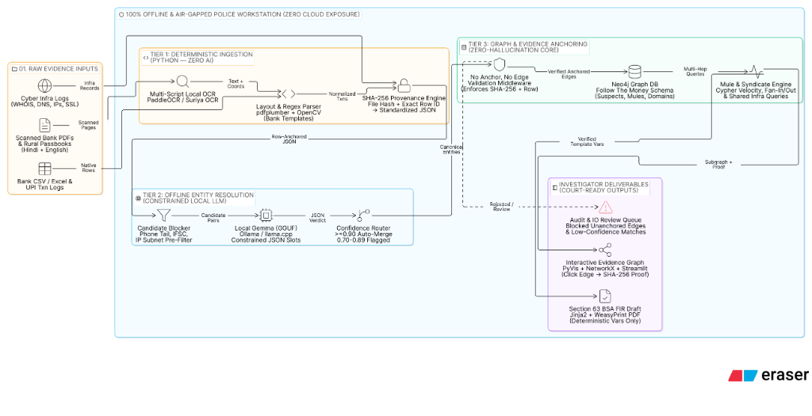
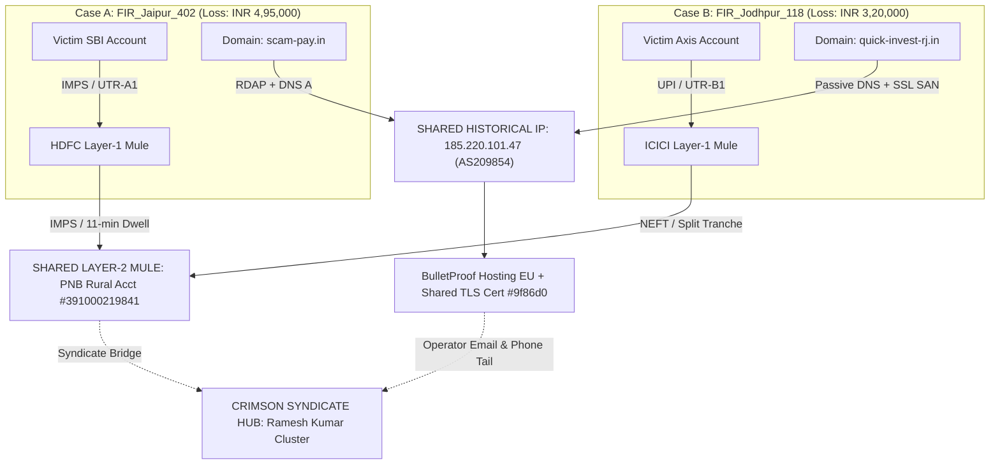

<p align="center">
  
</p>

<h1 align="center">GARUD (गरुड़)</h1>
<p align="center">
  <b>Follow the Money. Follow the Digital Footprint.</b><br/>
  <em>100% Offline-First, Air-Gapped Sovereign Financial Crime Infrastructure &amp; Money-Trail Evidence Generator for Indian Cyber Police Cells</em><br/>
  <sub>Built by <b>Team Garud (टीम गरुड़)</b> — Rajasthan Police Hackathon (PS05)</sub>
</p>

<p align="center">
  <a href="https://github.com/VarshneysvAI/Garud"></a>
  
  
  
  
  
  
  
</p>

---

> [!IMPORTANT]
> **Single Master Blueprint Notice:** This `README.md` is the **authoritative engineering blueprint and single source of truth** for **GARUD (गरुड़)**. Every data contract, pipeline invariant, graph constraint, legal template boundary, and module ownership rule defined below is binding across all 4 parallel engineering tracks before a single line of implementation code is written.

---

## Table of Contents

- [1. Executive Summary & Core Thesis](#1-executive-summary--core-thesis)
- [2. Core Engineering Philosophy: Solving the Three Fatal Blind Spots](#2-core-engineering-philosophy-solving-the-three-fatal-blind-spots)
- [3. Complete 3-Tier Intelligence Pipeline](#3-complete-3-tier-intelligence-pipeline)
  - [3.1 Architecture Flow Overview](#31-architecture-flow-overview)
  - [3.2 Tier 1: Deterministic Ingestion & Cyber Intelligence Normalization (Zero AI)](#32-tier-1-deterministic-ingestion--cyber-intelligence-normalization-zero-ai)
  - [3.3 Tier 2: Localized Entity Resolution Core (Offline Gemma via Ollama / llama.cpp)](#33-tier-2-localized-entity-resolution-core-offline-gemma-via-ollama--llamacpp)
  - [3.4 Tier 3: Cyber-Financial Graph, Cross-Case Syndicate Detection & Legal Workflow](#34-tier-3-cyber-financial-graph-cross-case-syndicate-detection--legal-workflow)
- [4. End-to-End Cross-Case Walkthrough (`FIR_Jaipur_402` + `FIR_Jodhpur_118`)](#4-end-to-end-cross-case-walkthrough-fir_jaipur_402--fir_jodhpur_118)
- [5. Complete Tech Stack & Local Hardware Specification](#5-complete-tech-stack--local-hardware-specification)
- [6. Repository Directory Structure, Golden Integration Contract & Team Ownership](#6-repository-directory-structure-golden-integration-contract--team-ownership)

---

## 1. Executive Summary & Core Thesis

**Problem Statement:** Rajasthan Police Hackathon — **PS05: Financial Crime Infrastructure & Money-Trail Analysis System**.

**Core Thesis — *"Follow the Money. Follow the Digital Footprint."***  
Cyber fraud syndicates do not operate inside a single bank statement or a single FIR. One scam cluster typically spans phishing domains, rotating bulletproof hosting ASNs, shared SSL infrastructure, SMS/WhatsApp lures, and rapid multi-hop UPI/IMPS/NEFT mule accounts spread across PSU banks, private banks, and rural cooperative passbooks across districts.

**GARUD (गरुड़)** by **Team Garud (टीम गरुड़)** is a lightweight, **100% offline-first, air-gapped sovereign Evidence Generator** engineered for standard **16 GB RAM CPU-only Indian police cyber-cell workstations**. Rather than acting as a chatty black-box AI assistant, GARUD ingests messy multi-bank statements alongside local cyber-infrastructure dumps, anchors every extracted fact to immutable **SHA-256** cryptographic provenance, resolves fragmented aliases using a grammar-constrained local LLM, exposes cross-case mule and hosting syndicates inside **Neo4j**, and outputs court-ready **Section 63 BSA (Bharatiya Sakshya Adhiniyam)** trails and **BNSS Section 94 / 106** draft lawful information/freeze notices.

### Why Existing Approaches Fail Indian Cyber Cells

| Dimension | Commercial AML / Graph Suites *(Senzing, TigerGraph, Cloud Compliance)* | Unconstrained Cloud / Chat LLMs | **GARUD (गरुड़) Sovereign Architecture** |
| :--- | :--- | :--- | :--- |
| **Data Sovereignty & Chain of Custody** | Cloud-hosted or server-cluster deployment violates strict police SOPs against uploading live FIR/KYC/bank data off-premises. | Sends raw victim & suspect PII, UTRs, and statements to third-party APIs; breaks evidentiary chain of custody. | **100% Air-Gapped Local Execution.** Police banking and KYC records never touch the internet. |
| **Indian Banking Mess & Bilingual Formats** | Built for clean Western SWIFT/ISO-20022 feeds; breaks on Indian PSU/rural passbooks, rotated scans, and Hindi+English narrations. | Misreads multi-column debit/credit alignment and silently drops low-clarity rows. | **Deterministic Layout OCR + Bank Templates:** PaddleOCR/Suriya + `pdfplumber`/OpenCV + strict bank Regex + confidence routing. |
| **Hallucination & Court Admissibility** | Rule-heavy enterprise tuning requires months of integration; misses Indian UPI/UTR nuance. | Invents plausible-looking UTRs, IFSCs, timestamps, or legal citations—rendering reports **legally inadmissible**. | **Zero-Hallucination Core:** "No Anchor, No Edge" graph enforcement + Jinja2/WeasyPrint deterministic slot injection. |
| **Hardware & Cost Footprint** | Heavy licensing costs and dedicated multi-node RAM/GPU infrastructure. | Per-token recurring API fees and vendor lock-in. | **Open-source stack on 16 GB RAM CPU workstation** (quantized Gemma 2B/4B GGUF + Neo4j CE / NetworkX fallback). |

---

## 2. Core Engineering Philosophy: Solving the Three Fatal Blind Spots

GARUD is designed around **three non-negotiable architectural defenses** against the failure modes that break field cyber-investigation software:

### Blind Spot 1 — The Indian Banking & OCR Mess
* **The Failure:** Cyber police receive evidence as native PDFs, password-unlocked exports, crooked mobile photos of rural cooperative passbooks, merged multi-line UPI narrations, and Hindi/regional Devanagari headers. Standard OCR scrambles Debit/Credit columns and shifts decimal points, corrupting the entire money trail before analysis even begins.
* **GARUD's Defense:** **Deterministic Pre-AI Normalization & Cryptographic Anchoring.** Before any AI component sees a byte of data, Tier 1 computes an immutable **SHA-256** hash of the source file, runs layout-aware local OCR (**PaddleOCR / Suriya OCR**) with bounding-box coordinate extraction, isolates columns via **`pdfplumber` / OpenCV** bank templates, normalizes fields through strict **Python Regex** rules, and records exact `ocr_confidence`. Any row falling below the strict OCR threshold is diverted into the **Investigator Verification Queue** rather than silently entering the graph.

### Blind Spot 2 — Zero Hallucination in Legal & FIR Outputs
* **The Failure:** If an LLM writes a single unverified account number, fabricates an IP attribution, or paraphrases a disputed transaction amount in an FIR annexure or bank freeze notice, defense counsel can challenge the entire investigation's credibility under Indian evidentiary law.
* **GARUD's Defense:** **Deterministic Constraint Parsing & Slot-Filling.** Local **Gemma** is strictly prohibited from writing freeform prose, summarizing financials, or inventing identifiers. Its sole function in Tier 2 is emitting **grammar-constrained JSON** match verdicts (`match_decision`, `confidence_score`, `matching_signals`, `canonical_entity_id`) over candidate pairs. All Section 63 BSA trails and BNSS lawful requests in Tier 3 are rendered deterministically via **Jinja2 + WeasyPrint** by injecting strictly verified, SHA-256-anchored database fields into vetted legal templates.

### Blind Spot 3 — Graph Integrity vs. Local LLM Context Limits
* **The Failure:** Real fraud networks involve thousands of transactions across dozens of accounts and multiple FIRs. Stuffing entire bank statements or multi-hop graphs into a 2B/4B local LLM context window causes severe attention drift, missed links, and O(n²) latency spikes on CPU hardware.
* **GARUD's Defense:** **Stateless Micro-Resolution + Graph Offloading.** Deterministic **Candidate Blocking** shrinks comparisons to tiny, high-signal pairs (shared phone tail, IFSC branch, phonetic key, IP/ASN subnet, SSL fingerprint). Gemma evaluates one candidate pair at a time statelessly. Once anchored, **100% of multi-hop money flow, pass-through velocity calculation, and cross-case syndicate clustering** runs inside **Neo4j Community Edition** (with an automatic **NetworkX** fallback on constrained machines).

---

## 3. Complete 3-Tier Intelligence Pipeline

### 3.1 Architecture Flow Overview

```mermaid
flowchart LR
    subgraph AIRGAP["AIR-GAPPED POLICE WORKSTATION (100% OFFLINE / ZERO CLOUD EXPOSURE)"]
        direction LR
        subgraph INPUTS["01. Raw Case Inputs"]
            B["Indian Bank PDFs / CSVs &amp; Rural Passbooks"]
            C["Local Cyber Infra Dumps (RDAP, DNS, ASN, SSL, Passive IP)"]
            M["Multi-Case FIR Metadata"]
        end

        subgraph T1["TIER 1: Deterministic Ingestion (Zero AI)"]
            OCR["PaddleOCR / Suriya OCR + OpenCV / pdfplumber"]
            CYB["Cyber Intel Parsers (RDAP, DNS, ASN, SSL, Hist-IP)"]
            HASH["SHA-256 File &amp; Row Anchor Engine"]
            OCR --> HASH
            CYB --> HASH
        end

        subgraph T2["TIER 2: Entity Resolution Core"]
            BLK["Candidate Blocker (Phone Tail, IFSC, IP/ASN, SSL)"]
            LLM["Offline Gemma GGUF (Constrained JSON Slots Only)"]
            RTR{"Confidence Router"}
            BLK --> LLM --> RTR
        end

        subgraph T3["TIER 3: Graph &amp; Legal Engine"]
            GUARD["No Anchor, No Edge Middleware"]
            NEO[("Neo4j CE / NetworkX Graph DB")]
            SYN["Cross-Case Syndicate &amp; Velocity Analytics"]
            GUARD --> NEO --> SYN
        end

        subgraph OUT["Court-Ready Investigator Deliverables"]
            QUEUE["Investigator Verification Queue (Needs IO Sign-Off)"]
            VIS["Interactive Evidence Graph (PyVis + Streamlit)"]
            LEG["Jinja2 + WeasyPrint (Sec 63 BSA FIR &amp; BNSS 94/106 Notices)"]
        end

        B --> OCR
        M --> HASH
        C --> CYB
        HASH -->|"transactions.json + cyber_infra.json"| BLK
        RTR -->|"&gt;= 0.90 Auto-Merge"| GUARD
        RTR -->|"0.70 - 0.89 Flagged"| QUEUE
        QUEUE -->|"IO Approved"| GUARD
        GUARD -->|"Unanchored Blocked"| QUEUE
        SYN --> VIS
        SYN --> LEG
    end
```

<p align="center">
  
</p>



---

### 3.2 Tier 1: Deterministic Ingestion & Cyber Intelligence Normalization (Zero AI)

Tier 1 runs **zero generative AI models**. Every step is deterministic, reproducible, and cryptographically fingerprinted.

#### A. Financial Ingestion Workflow
1. **Immutable Raw Fingerprinting:** Computes `file_sha256` (`hashlib.sha256`) on every bank PDF, CSV, Excel sheet, or scanned rural passbook image before reading contents.
2. **Layout-Aware Local OCR & Table Isolation:**
   - Native digital PDFs route through **`pdfplumber`** coordinate table extractors.
   - Scanned passbooks and rotated/skewed mobile images route through **OpenCV** deskewing/adaptive thresholding, followed by local **PaddleOCR / Suriya OCR** (Hindi Devanagari + English multi-script) retaining exact bounding-box coordinates and per-cell `ocr_confidence`.
3. **Bank-Specific Regex Normalization & Confidence Gate:**
   - Standardized parsers for SBI, HDFC, ICICI, PNB, Axis, and regional/cooperative passbook layouts extract `txn_date_ist`, `utr_or_ref`, `amount_inr`, `direction` (`DEBIT`/`CREDIT`), `rail` (`UPI`/`IMPS`/`NEFT`/`RTGS`/`CASH`), `counterparty_name`, `counterparty_account`, and `ifsc`.
   - Any row with `ocr_confidence < 0.85` or unbalanced running-balance math is marked `needs_ocr_review: true` so Investigators verify it explicitly instead of corrupting downstream hops.

#### B. Advanced Cyber Intelligence Ingestion (Dual-Mode Offline-Safe)
GARUD connects money trails directly to the technical attack infrastructure behind scam portals, APK command servers, and phishing domains:
- **RDAP / WHOIS Records:** Domain registration timestamps, registrar IANA ID, abuse contact email, status flags (`clientTransferProhibited`, recent registration bursts), and redacted/raw registrant strings.
- **DNS Records:** Full resolution snapshots across `A`, `AAAA`, `MX`, `NS`, and `TXT` (SPF/DMARC/verification tokens exposing operator domains).
- **ASN & Hosting-Provider Detection:** Maps resolved IPs to Autonomous System Numbers (`ASxxxxx`), CIDR prefixes, upstream transit, and bulletproof/offshore hosting providers (`isp`, `org`, `abuse_mailbox`).
- **SSL/TLS Certificate Fingerprints & SANs:** Extracts certificate `sha256_fingerprint`, issuer CN, validity window, and **Subject Alternative Names (SANs)**—frequently exposing co-hosted scam domains sharing the exact same TLS cert.
- **Historical IP-to-Domain & Passive DNS Relationships:** Captures pre-takedown hosting footprints (`first_seen`, `last_seen`, historical IP pivots) so switching Cloudflare/CDN behind a domain later does not erase earlier origin-server overlaps.

> [!NOTE]
> **Dual-Mode Air-Gapped Security Guarantee:**
> The core GARUD police workstation has **zero internet access** and strictly ingests locally exported, SHA-256-hashed OSINT bundles (`data/raw_inputs/cyber_infra_dumps/*.json|*.csv`). When cyber-cell analysts need fresh lookups for suspect domains/IPs, a decoupled triage collection script runs on a **separate internet-facing OSINT terminal** (containing **no** victim names, **no** bank statements, and **no** FIR KYC files), hashes the collected RDAP/DNS/ASN/SSL bundle, and transfers it across via read-only media.

#### C. Tier 1 JSON Data Contracts

##### `data/tier1_parsed/transactions.json`
```json
{
  "schema_version": "1.0.0",
  "case_id": "FIR_Jaipur_402",
  "generated_at_utc": "2026-11-24T10:15:00Z",
  "records": [
    {
      "record_id": "txn_402_00014",
      "case_id": "FIR_Jaipur_402",
      "account_number": "50100482910442",
      "bank_name": "HDFC",
      "ifsc": "HDFC0001204",
      "txn_timestamp_ist": "2026-11-12T14:22:18+05:30",
      "utr_or_ref": "431714889201",
      "rail": "IMPS",
      "direction": "DEBIT",
      "amount_inr": 245000.00,
      "running_balance_inr": 1420.50,
      "counterparty_raw": "IMPS/431714889201/R KUMAR/PUNB0041200/391000219841",
      "counterparty_account": "391000219841",
      "counterparty_ifsc": "PUNB0041200",
      "counterparty_name_raw": "R KUMAR",
      "provenance": {
        "source_file": "data/raw_inputs/bank_statements/hdfc_mule_402.pdf",
        "source_row": "page_2:row_14",
        "file_sha256": "e3b0c44298fc1c149afbf4c8996fb92427ae41e4649b934ca495991b7852b855",
        "ingested_at_utc": "2026-11-24T10:14:58Z",
        "ocr_confidence": 1.0,
        "extraction_method": "pdfplumber_regex_hdfc_v1",
        "needs_ocr_review": false
      }
    }
  ]
}
```

##### `data/tier1_parsed/cyber_infra.json`
```json
{
  "schema_version": "1.0.0",
  "case_id": "FIR_Jaipur_402",
  "generated_at_utc": "2026-11-24T10:16:10Z",
  "records": [
    {
      "infra_id": "infra_402_00001",
      "case_id": "FIR_Jaipur_402",
      "domain": "scam-pay.in",
      "rdap_whois": {
        "registrar_name": "PDR Ltd. d/b/a PublicDomainRegistry.com",
        "registrar_iana_id": "303",
        "registrar_abuse_email": "abuse-contact@publicdomainregistry.com",
        "created_at_utc": "2026-10-28T06:11:40Z",
        "registrant_name_raw": "Ramesh K",
        "registrant_email": "ramesh.k@scam-pay.in",
        "registrant_phone_raw": "+91-98290-XX412",
        "name_servers": ["ns1.offshore-dns.net", "ns2.offshore-dns.net"]
      },
      "dns_records": {
        "A": ["185.220.101.47"],
        "AAAA": [],
        "MX": ["10 mail.scam-pay.in"],
        "NS": ["ns1.offshore-dns.net", "ns2.offshore-dns.net"],
        "TXT": ["v=spf1 ip4:185.220.101.0/24 ~all"]
      },
      "network_asn": {
        "ip_address": "185.220.101.47",
        "asn": "AS209854",
        "asn_org": "BulletProof Hosting EU Ltd",
        "hosting_provider": "BulletProof Hosting EU",
        "cidr": "185.220.101.0/24",
        "country_code": "NL",
        "abuse_email": "noc-abuse@bph-eu.example"
      },
      "ssl_certificate": {
        "sha256_fingerprint": "9f86d081884c7d659a2feaa0c55ad015a3bf4f1b2b0b822cd15d6c15b0f00a08",
        "subject_cn": "*.scam-pay.in",
        "issuer_cn": "Let's Encrypt E5",
        "san_domains": ["scam-pay.in", "portal.quick-invest-rj.in"],
        "not_before_utc": "2026-10-29T00:00:00Z",
        "not_after_utc": "2027-01-27T00:00:00Z"
      },
      "historical_ips": [
        {
          "ip": "185.220.101.47",
          "first_seen_utc": "2026-10-28T07:00:00Z",
          "last_seen_utc": "2026-11-18T19:30:00Z",
          "source": "passive_dns_offline_bundle"
        }
      ],
      "provenance": {
        "source_file": "data/raw_inputs/cyber_infra_dumps/jaipur_402_osint_bundle.json",
        "source_row": "domains[0]",
        "file_sha256": "4b227777d4dd1fc61c6f884f48641d02b4d121d3fd328cb08b5531fcacdabf8a",
        "ingested_at_utc": "2026-11-24T10:16:08Z",
        "collection_mode": "decoupled_osint_bundle"
      }
    }
  ]
}
```

---

### 3.3 Tier 2: Localized Entity Resolution Core (Offline Gemma via Ollama / llama.cpp)

Indian fraudsters deliberately fragment names across accounts and domain registrations (`"Ramesh K"`, `"R. Kumar | Jaipur"`, `"RAMESH KUMAR S/O MOHAN"`, `"ramesh.k@scam-pay.in"`). Tier 2 resolves those aliases safely on local CPU hardware without risking hallucinated merges.

1. **Deterministic Candidate Blocking (Eliminating $O(n^2)$ Comparisons):**
   Records from `tier1_parsed/` are indexed into candidate buckets using deterministic blocking keys before any model inference:
   - Phone last-4 digits & normalized ISD suffix
   - Double-Metaphone / Soundex phonetic name hash
   - IFSC branch prefix + city token
   - IP `/24` subnet, ASN number, SSL fingerprint, and email local-part stem
2. **Constrained Local Gemma Engine (GGUF via Ollama / `llama.cpp`):**
   - Runs quantized **Gemma 2B / 4B (`Q4_K_M` GGUF)** locally on CPU within a **16 GB RAM** budget.
   - Invoked strictly with **GBNF grammar / JSON Schema structured output**, locking output tokens to four deterministic fields: `match_decision`, `confidence_score`, `matching_signals`, and `canonical_entity_id`. It never emits narrative text or edits monetary values.
3. **Human-in-the-Loop Confidence Router:**
   - `>= 0.90`: **Auto-Merged** into `canonical_entities.json` with full candidate pair provenance and deterministic signal list.
   - `0.70 – 0.89`: **Routed to `NEEDS_IO_REVIEW`** inside `io_review_queue.json`. The Investigating Officer (IO) reviews side-by-side raw source snippets and clicks **Approve Merge** or **Reject Match** before the link can enter court deliverables.
   - `< 0.70`: **Rejected / Kept Separate** to prevent false accusations.
4. **OpenSanctions "Follow The Money" (FtM) Ontology Alignment:**
   All canonical nodes conform cleanly to forensic FtM schemas:
   `Case` · `SuspectCluster` · `Person` · `BankAccount` · `MuleAccount` · `Transaction` · `PhoneNumber` · `Domain` · `IPAddress` · `ASN` · `HostingProvider` · `SSLCertificate`.

#### Tier 2 JSON Data Contracts

##### `data/tier2_resolved/canonical_entities.json`
```json
{
  "schema_version": "1.0.0",
  "generated_at_utc": "2026-11-24T10:18:22Z",
  "entities": [
    {
      "canonical_entity_id": "ftm_person_syn_009",
      "ftm_schema": "Person",
      "canonical_label": "Ramesh Kumar",
      "aliases": ["Ramesh K", "R KUMAR", "ramesh.k@scam-pay.in"],
      "resolution_status": "AUTO_MERGED",
      "confidence_score": 0.94,
      "match_decision": "SAME_ENTITY",
      "matching_signals": [
        "phone_last4_match:x412",
        "email_prefix_name_match:ramesh.k",
        "phonetic_token_match:RMXK"
      ],
      "source_record_refs": ["txn_402_00014", "infra_402_00001"],
      "io_verified": false,
      "provenance_hashes": [
        "e3b0c44298fc1c149afbf4c8996fb92427ae41e4649b934ca495991b7852b855",
        "4b227777d4dd1fc61c6f884f48641d02b4d121d3fd328cb08b5531fcacdabf8a"
      ]
    }
  ]
}
```

##### `data/tier2_resolved/io_review_queue.json`
```json
{
  "schema_version": "1.0.0",
  "generated_at_utc": "2026-11-24T10:18:25Z",
  "pending_reviews": [
    {
      "review_id": "rev_0041",
      "review_type": "ENTITY_MERGE_CANDIDATE",
      "status": "NEEDS_IO_REVIEW",
      "proposed_canonical_id": "ftm_person_syn_009",
      "left_record_ref": "infra_118_00003",
      "right_record_ref": "txn_402_00014",
      "llm_verdict": {
        "match_decision": "PROBABLE_SAME_ENTITY",
        "confidence_score": 0.81,
        "matching_signals": ["shared_ifsc_branch:PUNB0041200", "fuzzy_surname_initial:KUMAR"],
        "canonical_entity_id": "ftm_person_syn_009"
      },
      "io_decision": null,
      "io_badge_id": null,
      "reviewed_at_utc": null
    }
  ]
}
```

---

### 3.4 Tier 3: Cyber-Financial Graph, Cross-Case Syndicate Detection & Legal Workflow

#### A. Automated Evidence Anchoring ("No Anchor, No Edge" Middleware)
Every relationship written into **Neo4j Community Edition** (or **NetworkX** fallback) must pass strict validation middleware. Any candidate edge missing cryptographic provenance, source row coordinates, or script verification is **hard-rejected** and logged to the Audit & IO Review Queue—making ungrounded graph fabrication structurally impossible.

##### `neo4j_edge_anchor.json` Contract
```json
{
  "schema_version": "1.0.0",
  "edge_id": "edge_402_tr_889201",
  "from_node": { "ftm_schema": "MuleAccount", "id": "acct_hdfc_50100482910442" },
  "to_node": { "ftm_schema": "MuleAccount", "id": "acct_pnb_391000219841" },
  "relationship_type": "TRANSFERRED_TO",
  "edge_properties": {
    "utr_or_ref": "431714889201",
    "amount_inr": 245000.00,
    "rail": "IMPS",
    "txn_timestamp_ist": "2026-11-12T14:22:18+05:30"
  },
  "anchor": {
    "proof_type": "BANK_STATEMENT_ROW",
    "source_file": "data/raw_inputs/bank_statements/hdfc_mule_402.pdf",
    "source_row": "page_2:row_14",
    "timestamp_utc": "2026-11-24T10:14:58Z",
    "file_sha256": "e3b0c44298fc1c149afbf4c8996fb92427ae41e4649b934ca495991b7852b855",
    "verified_by_script": "tier1_ingestion/bank_parsers/hdfc_parser@1.0.0",
    "io_verified": true
  }
}
```

#### B. Cross-Case Syndicate Detection Engine (Graph Playbooks)
Every entity in the graph links back to one or more `Case` / `FIR` nodes via `INVOLVED_IN_CASE` edges, enabling automated multi-district and cross-FIR intelligence:

| Detection Playbook | Graph Pattern Queried | Forensic Signal Surfaced for IO |
| :--- | :--- | :--- |
| **1. Cross-Case Mule & UTR Bridges** | Shared `MuleAccount` or chained `utr_or_ref` reachable from $\ge 2$ distinct `Case` nodes | Exposes one central cash-out mule serving multiple unrelated police stations. |
| **2. Shared Cyber Infrastructure Pivot** | Distinct scam `Domain` nodes across $\ge 2$ `Case` nodes converging on common `IPAddress`, `ASN`, `HostingProvider`, `SSLCertificate` SAN, or registrant email | Proves two different brand-name scam portals are operated by the same technical syndicate. |
| **3. Rapid Pass-Through Velocity** | Incoming `CREDIT` and outgoing `DEBIT` on the same `BankAccount` within `< 15 minutes` ($\ge 85\%$ value retention) | Flags high-confidence automated Layer-1 / Layer-2 mule accounts prior to ATM/crypto cash-out. |
| **4. Fan-In Aggregation & Fan-Out Smurfing** | High in-degree victims $\rightarrow$ single hub (`Fan-In`), or single hub splitting into sub-₹50,000 tranches (`Fan-Out`) | Identifies syndicate controller accounts and threshold-evading structuring bursts. |

#### C. Interactive Evidence Graph & Deterministic Legal Workflow

* **Interactive Evidence Graph (`PyVis + NetworkX + Streamlit`):**
  Generates self-contained offline HTML graphs embedded inside the local Streamlit Investigator Console with strict forensic color semantics:
  - **Crimson (`#DC2626`)** — Cross-Case Syndicate Hubs & Common Operators
  - **Amber (`#D97706`)** — Flagged Layer-1 / Layer-2 Mule Bank Accounts
  - **Cyan (`#0891B2`)** — Cyber Infrastructure (`Domain`, `IPAddress`, `ASN`, `HostingProvider`, `SSLCertificate`)
  - **Purple (`#7C3AED`)** — Cross-Case `FIR` / `Case` Bridge Nodes  
  Clicking **any node or edge** opens the **Proof & IO Sign-Off Drawer** displaying exact `source_file`, `source_row`, `file_sha256`, `ocr_confidence`, and one-click IO verification approval.

* **Deterministic Legal Document Exporter (`Jinja2 + WeasyPrint`):**
  Zero AI prose generation. Strictly injects `io_verified` / anchored graph variables into statutory templates:
  1. **Section 63 BSA (Bharatiya Sakshya Adhiniyam) Preliminary Financial Trail & FIR Report** — Complete hop-by-hop ledger table, SHA-256 digital evidence annexure, hash manifest, and IO verification timestamp.
  2. **Draft Lawful Information & Account Freeze Request to Banks (`BNSS Section 94 / 106`)** — Cites exact mule account numbers, IFSCs, disputed UTRs, transaction timestamps, and debit-freeze/KYC requisition items.
  3. **Draft Lawful Information & Preservation Request to Domain Registrars & Hosting Providers** — Cites exact domains, RDAP registrar IANA IDs, `ASN`, origin `IPAddress`, SSL SHA-256 fingerprints, DNS/access-log preservation windows, and billing/KYC details required under Indian law.

---

## 4. End-to-End Cross-Case Walkthrough (`FIR_Jaipur_402` + `FIR_Jodhpur_118`)

To demonstrate GARUD's cross-case intelligence in action, consider two seemingly independent cyber fraud complaints filed in two different Rajasthan districts:

* **Case A (`FIR_Jaipur_402`):** Victim defrauded of **₹4,95,000** via fake payment portal **`scam-pay[.]in`**. Funds move **Victim SBI $\rightarrow$ HDFC Layer-1 Mule $\rightarrow$ PNB Rural Cooperative Passbook (scanned photo)**.
* **Case B (`FIR_Jodhpur_118`):** Second victim defrauded of **₹3,20,000** via fake investment portal **`quick-invest-rj[.]in`** routed through an ICICI mule account.



### Minute-by-Minute Execution Trace

1. **Tier 1 (Deterministic Ingestion & Fingerprinting):**
   - Computes SHA-256 hashes for Jaipur's native SBI/HDFC PDFs, Jaipur's skewed mobile passbook photo (`pnb_rural_scan.jpg`), Jodhpur's ICICI CSV, and both offline OSINT infrastructure bundles.
   - `PaddleOCR` + OpenCV deskews the Hindi/English PNB rural passbook and flags one faint UTR digit (`ocr_confidence: 0.78`) into `needs_ocr_review` while normalizing clean rows into `transactions.json`.
   - Cyber Intel parser normalizes `scam-pay[.]in` and `quick-invest-rj[.]in` into `cyber_infra.json`, extracting RDAP registrar IANA IDs, `AS209854`, historical IP `185.220.101.47`, and shared SSL SAN certificate `9f86d081...`.
2. **Tier 2 (Candidate Blocking, Local Gemma & IO Queue):**
   - Candidate blocker pairs WHOIS registrant `"Ramesh K"` (`+91-98290-XX412`) with PNB passbook beneficiary `"R KUMAR"` and `ramesh.k@scam-pay.in`.
   - Local **Gemma GGUF** outputs constrained JSON (`SAME_ENTITY`, `0.94`), auto-merging into canonical cluster `ftm_person_syn_009`. A secondary probable match (`0.81`) from Jodhpur enters `io_review_queue.json`, where the IO verifies the raw scan and approves the merge.
3. **Tier 3 (Cross-Case Neo4j Detection & Legal Deliverables):**
   - Validation middleware verifies every `file_sha256` and `source_row` anchor before committing to Neo4j.
   - Cross-Case Syndicate Cypher queries trigger two simultaneous alerts: **(a)** financial convergence on shared Layer-2 PNB mule `391000219841` with an **11-minute pass-through dwell**, and **(b)** digital footprint convergence where both scam domains share **ASN `AS209854`**, **historical IP `185.220.101.47`**, and **TLS certificate SAN `9f86d081...`**.
   - Investigator exports the self-contained **PyVis interactive syndicate graph** plus deterministic PDFs: **(1)** Joint **Section 63 BSA** trail annexure, **(2)** **BNSS Sec 94/106** freeze/KYC requisitions to **PNB, HDFC, and ICICI**, and **(3)** Preservation & subscriber-info notices to **PDR Ltd. (IANA 303)** and **BulletProof Hosting EU (`AS209854`)**.

---

## 5. Complete Tech Stack & Local Hardware Specification

### Hardware & Sovereignty Target
- **Target Workstation:** Standard Indian Police Cyber Cell Desktop/Laptop (**16 GB RAM, x86_64 CPU-only, zero discrete GPU required**).
- **Execution Mode:** 100% offline air-gapped processing for all banking, KYC, graph, and legal generation steps; decoupled OSINT collection script only when external network queries are needed.

### Full Engineering Stack

| Pipeline Layer | Primary Tool | Exact Role in GARUD | Offline Privacy Status | Lightweight Fallback |
| :--- | :--- | :--- | :--- | :--- |
| **OCR & Image Cleanup** | **PaddleOCR + OpenCV** *(or Suriya OCR)* | Deskews rotated/blurry rural bank passbooks; multi-script Hindi + English text & coordinate extraction. | **100% Offline** (local model weights) | `pytesseract` (Tesseract offline binary) |
| **Deterministic Parsing** | **`pdfplumber` + Python `re`** | Column-aware extraction of native bank PDFs/CSVs & strict UTR/IFSC/INR regex validation. | **100% Offline** | `pypdf` + rule-based CSV normalizer |
| **Cyber Intelligence Parsers** | **`python-whois` / RDAP JSON + `dnspython` + `cryptography`** | Normalizes RDAP/WHOIS registrars, DNS (`A/AAAA/MX/NS/TXT`), ASN/ISP, SSL SHA-256/SANs, & passive IPs. | **Offline Bundle Ingestion** *(decoupled triage fetcher)* | Pure JSON/CSV schema loader on pre-fetched dumps |
| **Cryptographic Provenance** | **Python `hashlib` (`SHA-256`)** | Immutable file & row-level anchor generation prior to any downstream AI or graph insertion. | **100% Offline Stdlib** | Built-in deterministic checksums |
| **Local Entity Resolution** | **Gemma 2B/4B GGUF (`Ollama` / `llama.cpp`)** | Grammar-constrained JSON fuzzy alias scoring over pre-blocked candidate pairs only. | **100% Offline** (local CPU inference) | `rapidfuzz` + phonetic (`jellyfish`) scoring |
| **Graph Storage & Analytics** | **Neo4j Community Edition** | Stores "Follow The Money" ontology, enforces anchored edges, & runs cross-case syndicate Cypher queries. | **100% Offline Local DB** | Pure-Python **NetworkX** graph store |
| **Interactive Graph UI** | **PyVis + NetworkX + Streamlit** | Renders color-coded offline HTML evidence networks with click-to-proof & IO sign-off console. | **100% Offline Localhost** | Static SVG/PNG `matplotlib` export |
| **Legal Document Engine** | **Jinja2 + WeasyPrint** | Deterministically compiles Section 63 BSA reports & BNSS 94/106 bank/registrar/host notices into PDF. | **100% Offline** | `reportlab` deterministic PDF renderer |

---

## 6. Repository Directory Structure, Golden Integration Contract & Team Ownership

### Repository Tree

```text
Garud/
├── .gitignore
├── README.md                                  # THIS SINGLE MASTER BLUEPRINT FILE
├── data/
│   ├── raw_inputs/
│   │   ├── bank_statements/.gitkeep           # Native & scanned Indian bank PDFs / CSVs
│   │   ├── cyber_infra_dumps/.gitkeep         # Local RDAP, WHOIS, DNS, ASN, SSL & historical IP exports
│   │   └── cases_metadata/.gitkeep            # Multi-case FIR metadata manifests
│   ├── tier1_parsed/.gitkeep                  # Standardized row-anchored transactions & infra JSON
│   ├── tier2_resolved/.gitkeep                # Canonical entities, confidence scores & IO review queue JSON
│   └── outputs/
│       ├── graphs/.gitkeep                    # Exported offline PyVis interactive HTML graphs
│       └── legal_drafts/.gitkeep              # Generated BSA Sec 63 PDFs & lawful bank/registrar/host notices
├── tier1_ingestion/
│   ├── bank_parsers/.gitkeep                  # Bank-specific pdfplumber + OpenCV + Regex parser modules
│   ├── ocr/.gitkeep                           # PaddleOCR / Suriya local multi-script OCR engine
│   ├── cyber_intel/.gitkeep                   # RDAP/WHOIS, DNS, ASN, hosting provider, SSL & historical IP parsers
│   └── provenance/.gitkeep                    # SHA-256 file & row-level anchor generator
├── tier2_resolution/
│   ├── blocking/.gitkeep                      # Deterministic candidate pair blocker
│   ├── llm_resolver/.gitkeep                  # Offline Gemma (Ollama / llama.cpp) grammar-constrained slot-filler
│   └── verification_queue/.gitkeep            # Confidence router & Investigator Verification state manager
├── tier3_graph_legal/
│   ├── neo4j_core/.gitkeep                    # Neo4j loader + "No Anchor, No Edge" validation middleware
│   ├── syndicate_analytics/.gitkeep           # Cross-case syndicate detection & mule velocity Cypher queries
│   ├── visualization/.gitkeep                 # PyVis + NetworkX interactive evidence graph builder
│   └── legal_workflow/.gitkeep                # Jinja2 + WeasyPrint exporter (FIR, Bank, Registrar & Host notices)
├── templates/
│   ├── fir_sec63_bsa/.gitkeep                 # Section 63 BSA preliminary trail report template
│   ├── bank_requests/.gitkeep                 # Lawful bank freeze & KYC requisition templates (BNSS Sec 94/106)
│   └── infra_requests/.gitkeep                # Lawful registrar & hosting provider info/preservation templates
├── ui/
│   └── streamlit_app/.gitkeep                 # Unified offline local investigator dashboard & verification UI
├── tests/
│   └── adversarial/.gitkeep                   # Unanchored-edge rejection tests & offline air-gap checks
└── docs/
    ├── architecture_assets/.gitkeep
    ├── architecture_assets/garud_logo.png
    └── architecture_assets/garud_system_architecture.png
```

### The Golden Integration Rule (Zero-Conflict Parallel Engineering)

All 4 teammates develop in parallel across isolated directories, communicating **exclusively through the strict versioned JSON contracts** documented in Section 3:

1. **Contract Boundary 1 (`tier1_ingestion` $\rightarrow$ `data/tier1_parsed/`):** Must emit valid `transactions.json` and `cyber_infra.json` with complete `provenance` objects before Tier 2 reads them.
2. **Contract Boundary 2 (`tier2_resolution` $\rightarrow$ `data/tier2_resolved/`):** Must emit `canonical_entities.json` and `io_review_queue.json` using FtM node types without altering raw monetary amounts or `file_sha256`.
3. **Contract Boundary 3 (`tier3_graph_legal` $\rightarrow$ `neo4j_core`):** Rejects any relationship missing `neo4j_edge_anchor.json` provenance fields; renders deliverables only from anchored graph queries.

### 4-Teammate Parallel Ownership Matrix

| Track | Owned Directories | Primary Deliverables | Target Branch |
| :--- | :--- | :--- | :--- |
| **Track 1 — Tier 1 Ingestion & Cyber Intel** | `tier1_ingestion/`, `data/raw_inputs/` | Bank Regex/OCR parsers, RDAP/DNS/ASN/SSL parsers, SHA-256 anchor generator | `feat/tier1-ingestion` |
| **Track 2 — Tier 2 Entity Resolution** | `tier2_resolution/` | Candidate blocker, Gemma GGUF JSON slot-filler, confidence router & IO queue | `feat/tier2-resolution` |
| **Track 3 — Tier 3 Graph & Syndicate Engine** | `tier3_graph_legal/neo4j_core/`, `syndicate_analytics/`, `visualization/` | "No Anchor, No Edge" middleware, cross-case Cypher playbooks, PyVis graph | `feat/tier3-graph` |
| **Track 4 — Legal Templates, UI & Adversarial QA** | `tier3_graph_legal/legal_workflow/`, `templates/`, `ui/`, `tests/adversarial/` | Sec 63 BSA & BNSS 94/106 templates, Streamlit IO console, unanchored-edge tests | `feat/legal-ui-qa` |

---

<p align="center">
  <sub><b>GARUD (गरुड़)</b> — Engineered by <b>Team Garud (टीम गरुड़)</b> for Rajasthan Police Hackathon PS05 · Air-Gapped by Design · Court-Admissible by Construction</sub>
</p>
